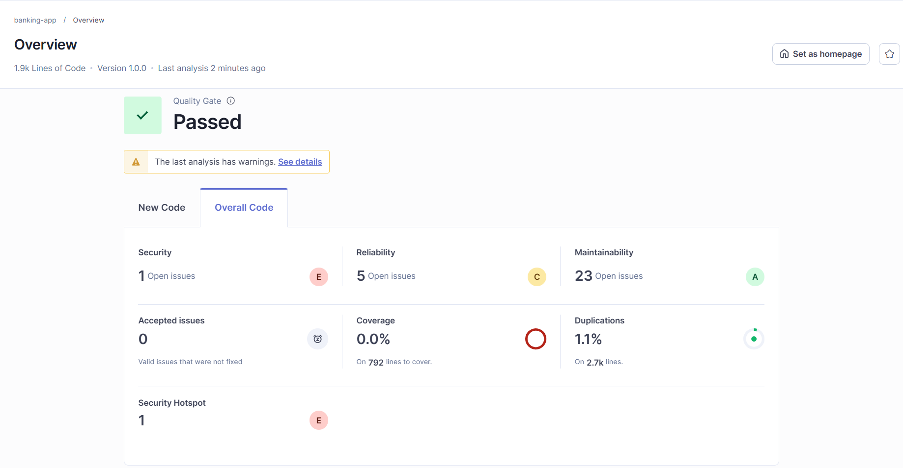
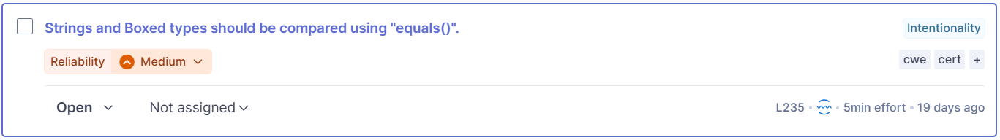
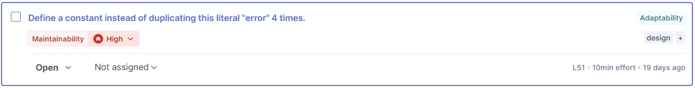
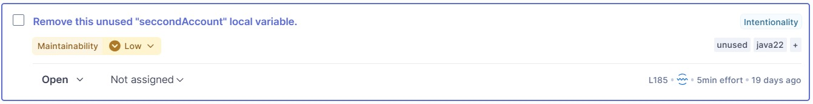

# Tarea 1 y 3: Análisis de Calidad del Código y Refactorización
**Grupo 3**

## Miembros del Equipo
| Nombre y Apellidos | Correo URJC | Usuario GitHub |
|:--- |:--- |:--- |
| Carla García Romero | c.garciarom.2023@alumnos.urjc.es | Carlss50 |
| Matias Maccarrone | ma.maccarrone.2023@alumnos.urjc.es | MatiasMaccarrone |
| Alejandro Carretero Badorrey | a.carreterob.2023@alumnos.urjc.es | Carretero2005 |
| Raúl Sánchez López | r.sanchezl.2023@alumnos.urjc.es | RaulSanchezLopez |

## Captura de Pantalla del Overview de SonarQube

## Análisis de Calidad - Issues 

A continuación se muestra un resumen de los issues encontrados en el análisis de calidad realizado con SonarQube y mediante el análisis manual del código:

### Issue 1: Las cadenas y los tipos encapsulados deben compararse usando equals().

**Reporte de la issue**  

  
**Explicación de los alumnos del mal olor detectado**  
- En este caso, se ha detectado un error real. En el código se están comparando dos Strings con el operador "==". Esto comprueba si las cadenas referencian al mismo objeto en memoria, no el valor de las cadenas.

**Refactorización**
https://github.com/carlss50/ais-2026-grupo-3/blob/8978f1b90abeadf5107d6acec548aeae717d00c8/src/main/java/es/codeurjc/service/AccountService.java#L235

- Se sustituye el operador == por .equals() para comparar los números de cuenta, ya que == compara referencias en memoria y no el valor de las cadenas, lo que podía provocar que la validación no funcionara correctamente.

### Issue 2: Duplicado de datos en `Deposit Confirmation`

**Reporte de la issue**  

  
**Explicación de los alumnos del mal olor detectado** 
- Se ha detectado el mal olor con el sonar. Se ha duplicado un string literal 4 veces, esto es código que duplica los datos. Esto dificulta el mantenimiento ya que, si lo quieres modificar lo tienes que modificar en múltiples puntos del código, lo que aumenta el riesgo de errores o inconsistencias.

**Refactorización**
https://github.com/carlss50/ais-2026-grupo-3/blob/5ab78a217b70844891d291d476cd9c0ab94ce03a/src/main/java/es/codeurjc/service/AccountService.java#L183-L188

- El String "Deposit Confirmation" era el titulo de la notificación a enviar, por tanto se agrupó bajo la variable "subject", y fueron reemplazados por ella.

### Issue 3: Eliminar la variable local "seccondAccount" no utilizada

**Reporte de la issue**  
 
  
**Explicación de los alumnos del mal olor detectado**   
- En este caso, no se trata de un falso positivo, ya que tras revisar toda la clase,  la variable `seccondAccount` no se inicializa ni se utiliza en ningún momento.  Además, su nombre contiene una errata, la palabra 'seccond' debería tener solo un 'c', lo que indica que se trata de código abandonado que debería eliminarse. 

**Refactorización**
https://github.com/carlss50/ais-2026-grupo-3/blob/feeb27a3bf9bbfcc6087be38df07d33bd72352bf/src/main/java/es/codeurjc/service/AccountService.java#L183-L185

- Para refactorizar este fragmento de código solo se ha eliminado la declaración de la variable `seccondAccount`.

### Issue 4: Código duplicado

**Reporte de la issue**:
https://github.com/carlss50/ais-2026-grupo-3/blob/b882778bd26e4f7b40fe0c02861ca24b8813fd37/src/main/java/es/codeurjc/service/AccountService.java#L73-L121

https://github.com/carlss50/ais-2026-grupo-3/blob/b882778bd26e4f7b40fe0c02861ca24b8813fd37/src/main/java/es/codeurjc/service/AccountService.java#L122-L169
  
**Explicación de los alumnos del mal olor detectado** 
- El mal olor fue detectado de forma manual, no por Sonar. Y el razonamiento para su detección, se basa en que son dos funciones con el mismo nombre y la misma funcionalidad, con la única diferencia en el parámetro "description". En la primera función se utiliza para describir la transacción y en la segunda, al no tenerlo, utiliza una cadena escrita predefinida "Quick Deposit", es decir, que la diferencia entre ambas funciones, es que tiene la descripción de la transacción como parámetro y la otra no.

**Refactorización**
https://github.com/carlss50/ais-2026-grupo-3/blob/187a47738e321abde677ca56453478c7a689173d/src/main/java/es/codeurjc/service/AccountService.java#L126-L130

- El `deposit` de dos parametros de entrada delega su lógica en el de tres entradas pasando como tercer valor "Quick Deposit" que es el valor por defecto.

### Issue 5: Lógica redundante y mensajes duplicados en validaciones de `amount`

**Reporte de la issue**:
https://github.com/carlss50/ais-2026-grupo-3/blob/72cb3440fb9b3173236f3e6f84a71ec960b5630c/src/main/java/es/codeurjc/service/AccountService.java#L78-L83

https://github.com/carlss50/ais-2026-grupo-3/blob/72cb3440fb9b3173236f3e6f84a71ec960b5630c/src/main/java/es/codeurjc/service/AccountService.java#L84-L89
  
**Explicación de los alumnos del mal olor detectado** 
- Se ha detectado este mal olor de manera manual, no por Sonar. Se ha detectado lógica redundante haciendo que lancen la misma excepción con el mismo mensaje para casos que podrían agruparse. Esto dificulta el mantenimiento ya que si lo quieres modificar, lo tienes que modificar en múltiples puntos del código, lo que aumenta riesgo de errores o inconsistencias.

**Refactorización**
https://github.com/carlss50/ais-2026-grupo-3/blob/8978f1b90abeadf5107d6acec548aeae717d00c8/src/main/java/es/codeurjc/service/AccountService.java#L143-L148

- Se unifican los dos if separados para amount == 0 y amount < 0 en uno solo con amount <= 0, eliminando además la rama inalcanzable amount > 50000 ya que el if anterior con amount > 10000 siempre se ejecuta antes.

### Issue 6: Duplicación de la lógica de notificaciones en los métodos deposit, withdraw y transfer

**Reporte de la issue**:
https://github.com/carlss50/ais-2026-grupo-3/blob/6d06bb533900cb3ba50d3f857b002d60045ae67f/src/main/java/es/codeurjc/service/AccountService.java#L103-L117  
https://github.com/carlss50/ais-2026-grupo-3/blob/6d06bb533900cb3ba50d3f857b002d60045ae67f/src/main/java/es/codeurjc/service/AccountService.java#L151-L166  
https://github.com/carlss50/ais-2026-grupo-3/blob/6d06bb533900cb3ba50d3f857b002d60045ae67f/src/main/java/es/codeurjc/service/AccountService.java#L202-L214  
https://github.com/carlss50/ais-2026-grupo-3/blob/6d06bb533900cb3ba50d3f857b002d60045ae67f/src/main/java/es/codeurjc/service/AccountService.java#L266-L296  
  
**Explicación de los alumnos del mal olor detectado** 
- Este bloque de código que gestiona el envío de notificaciones según el tipo de usuario  (EMAIL o SMS) se repite de forma casi idéntica en los métodos `deposit`, `withdraw` y `transfer`. Esto viola el principio DRY (Don't Repeat Yourself), por lo que debería extraerse a un método privado reutilizable.

**Refactorización**
https://github.com/carlss50/ais-2026-grupo-3/blob/5ab78a217b70844891d291d476cd9c0ab94ce03a/src/main/java/es/codeurjc/service/AccountService.java#L307-L318

- Para solucionarse, se creó un método privado llamado "sendNotification", el cual sigue la misma lógica que los if-else de los métodos. Tiene como parámetros, la cuenta a la que se envia la notificación, el tipo de notificación y los titulos y cuerpos de los mensajes, tanto para SMS, como para EMAIL (dentro del método se decide por donde enviarla).

### Issue 7: Nombre de método poco descriptivo

**Reporte de la issue**:
https://github.com/carlss50/ais-2026-grupo-3/blob/21076e9c58c06f8d18c8acaa5a331113f9bd9b8d/src/main/java/es/codeurjc/service/AccountService.java#L301
  
**Explicación de los alumnos del mal olor detectado** 
- El mal olor fue detecado de forma manual, al tener que mirar el comentario para saber qué hace la función. El nombre "rm" es utilizado en Unix para la función de borrado, sin embargo, no siempre se sabe esto o tampoco se lo puede relacionar de forma directa, por tanto, debería tener un nombre corto que oriente hacia la funcionalidad.

**Refactorización**
https://github.com/carlss50/ais-2026-grupo-3/blob/c11ebb8b0a072472c12e700448a10129cf34a5e4/src/main/java/es/codeurjc/service/AccountService.java#L300

- Esta refactorización ha consistido en el cambio del nombre de método de `rm` a `deleteAccount`. Además, se ha actualizado el nombre de los métodos de test relacionados con esta función, para que sean coherentes con el nuevo nombre del método.

### Issue 8: Variables poco descriptivas ('m' y 'o')

**Reporte de la issue**:
https://github.com/carlss50/ais-2026-grupo-3/blob/6d06bb533900cb3ba50d3f857b002d60045ae67f/src/main/java/es/codeurjc/service/AccountService.java#L231-L232
  
**Explicación de los alumnos del mal olor detectado** 
- Existen dos variables (m y o) inicializadas con nombres poco descriptivos. Es recomendable renombrarlas como sourceAccount y destinationAccount.

**Refactorización**

https://github.com/carlss50/ais-2026-grupo-3/blob/187a47738e321abde677ca56453478c7a689173d/src/main/java/es/codeurjc/service/AccountService.java#L192-L193

- Se han renombrado las variables `m` y `o` por nombres más descriptivos: `sourceAccount` y `destinationAccount` respectivamente.

### Issue 9: Método largo (Deposit)

**Reporte de la issue**:
https://github.com/carlss50/ais-2026-grupo-3/blob/ba8221d17ab4ecc5cf7a5f8c116f3ea91579c438/src/main/java/es/codeurjc/service/AccountService.java#L77-L120

**Explicación de los alumnos del mal olor detectado** 
- El método deposit() es largo (42 líneas de código), lo que dificulta su lectura, testeo y reutilización.

**Refactorización**

https://github.com/carlss50/ais-2026-grupo-3/blob/02ba3d91dee8e97714e7672b1e13e869cbc06e6f/src/main/java/es/codeurjc/service/AccountService.java#L104-L126

- Esta refactorización ha consistido en extraer la lógica de validación de amount a un método privado `checkAmount`, la lógica de crear y guardar un deposito en la base de datos a un método privado `saveTransaction`. Esto, además de reducir la longitud del método `deposit`, lo ha mejorado haciéndolo más legible, más facil de testear y más sencillo de reutilizar.
 
### Issue 10: Método largo (Withdraw)

**Reporte de la issue**:
https://github.com/carlss50/ais-2026-grupo-3/blob/0139624fc7fe9e356cb0cf92ef6bd066ad234b44/src/main/java/es/codeurjc/service/AccountService.java#L175-L217

**Explicación de los alumnos del mal olor detectado** 
- El método withdraw() es largo (42 líneas de código), lo que dificulta su lectura, testeo y reutilización.

**Refactorización**
https://github.com/carlss50/ais-2026-grupo-3/blob/0f4ca5c73a375d6d26ef7f9ba18ac83f4afbbbd8/src/main/java/es/codeurjc/service/AccountService.java#L205-L214

- Esta refactorización ha consistido en extraer la lógica de validación de amount a un método privado `checkAmount`, la lógica de verificación de fondos a un método privado `checkSufficientFunds`, y la lógica de guardado de transacciones a un método privado `saveTransaction`. Esto ha permitido reducir la longitud del método `withdraw` y mejorar su legibilidad, testeo y reutilización.
- La refactorización de la lógica de envío de notificaciones se ha solucionado en el Issue 6, por lo que no se ha incluido en esta refactorización.

### Issue 11: Método largo (Transfer)

**Reporte de la issue**:
https://github.com/carlss50/ais-2026-grupo-3/blob/cf85e611bfb16f5c1a8b4fba760fe5f8b644833e/src/main/java/es/codeurjc/service/AccountService.java#L223-L295

**Explicación de los alumnos del mal olor detectado** 
- El método transfer() es largo (72 líneas de código), lo que dificulta su lectura, testeo y reutilización.

**Refactorización**
https://github.com/carlss50/ais-2026-grupo-3/blob/8978f1b90abeadf5107d6acec548aeae717d00c8/src/main/java/es/codeurjc/service/AccountService.java#L197-L254

-  Se extrae la lógica del método transfer() en tres métodos privados (validateTransferAmount, validateTransferAccounts y saveTransferTransactions), reduciendo el método de 72 líneas a unas 15, mejorando así la legibilidad y mantenibilidad del código.

