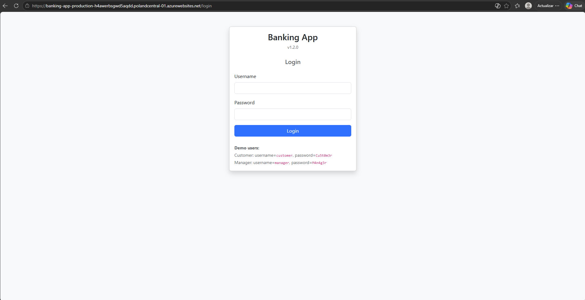
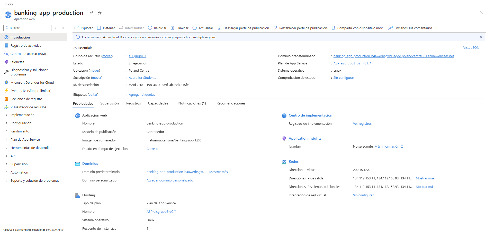
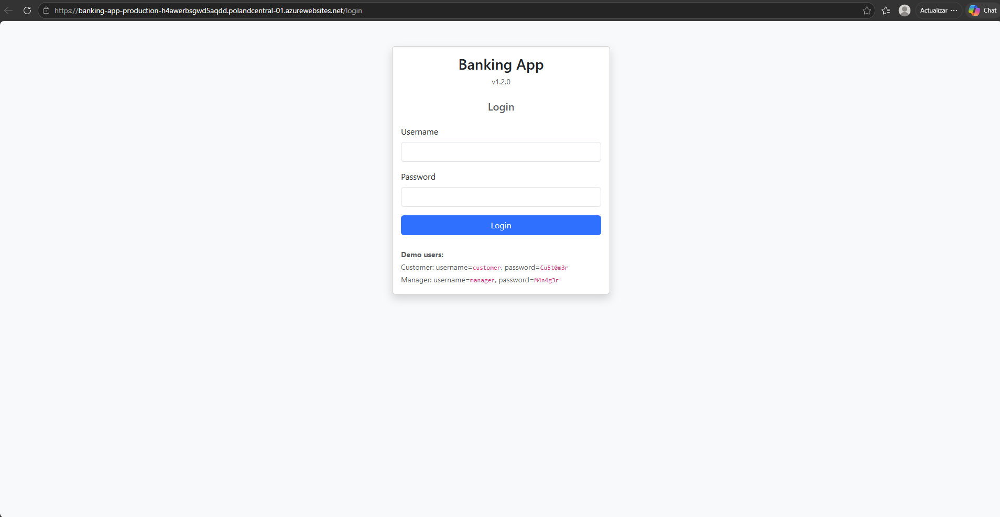
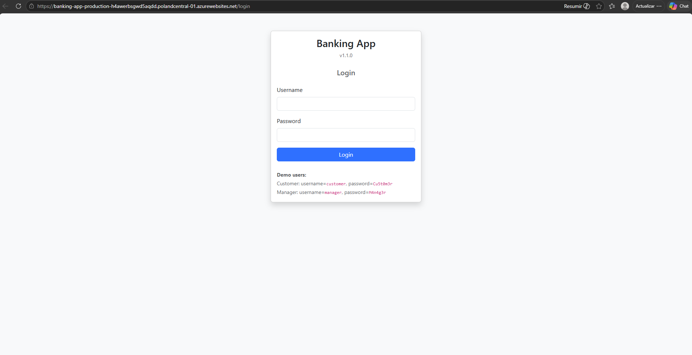

# Praćtica 1 - Control de calidad de una aplicación web 

**Grupo 3**

## Miembros del Equipo
| Nombre y Apellidos | Correo URJC | Usuario GitHub |
|:--- |:--- |:--- |
| Carla García Romero | c.garciarom.2023@alumnos.urjc.es | Carlss50 |
| Matias Maccarrone | ma.maccarrone.2023@alumnos.urjc.es | MatiasMaccarrone |
| Alejandro Carretero Badorrey | a.carreterob.2023@alumnos.urjc.es | Carretero2005 |
| Raúl Sánchez López | r.sanchezl.2023@alumnos.urjc.es | RaulSanchezLopez |

---

### **Participación de Miembros en la Práctica 1**

#### **Alumno 1 - Carla García Romero**

* **Tarea 1:** En esta sección he explicado las deficiencias encontrados en el código, como la incorrecta comparación de strings, el uso de variables poco claras y la existencia de métodos extensos.
* **Tarea 2:** Las pruebas realizadas se centran en la función `deposit()` y en validar que, tras realizar una transacción, el saldo de la cuenta de destino se incremente correctamente.
* **Tarea 3:** Durante la refactorización, he eliminado la variable no utilizada `seccondAccount`, renombrado el método `rm()` por `deleteAccount()` ya que era más descriptivo y simplificado `withdraw()` para reducir su longitud y sus responsabilidades.
* **Tarea 4:** Me ha tocado desarrollar mediante TDD la lógica del límite de cuota, asegurando que no se superara el 40% de los ingresos mensuales del cliente. Además, me he encargado de la construcción del método `evaluate()` en LoanApprovalAlgorithm usando el código proporcionado por mis compañeros.
* **Tarea 5:** La prueba de sistema que he implementado consiste en verificar que el software impida realizar transferencias cuando la cuenta de origen y destino coinciden. 

Adicionalmente, he supervisado la ausencia de código duplicado y he verificado que los métodos no contuvieran funcionalidades innecesarias.


| Nº    | Commits      |
|:------------: |:------------:|
|1| Issues: [1 y 8](https://github.com/carlss50/ais-2026-grupo-3/commit/72cb3440fb9b3173236f3e6f84a71ec960b5630c), [9](https://github.com/carlss50/ais-2026-grupo-3/commit/9b49fd1e2d47981353e755957a4d42bbbaf1f077)  |
|2| Pruebas unitarias: [5](https://github.com/carlss50/ais-2026-grupo-3/commit/b85dba962bfe9f4ebb06cd1174893f3847aa0004), [6](https://github.com/carlss50/ais-2026-grupo-3/commit/ea3b1adba885363e2d0fce3595c1aa87d421a457), [7](https://github.com/carlss50/ais-2026-grupo-3/commit/d7ee1649f643388608d87789bd3cdc53113aa7b0), [8](https://github.com/carlss50/ais-2026-grupo-3/commit/6e598790b232f333e7045768fd8af6fa9467dacb), [9](https://github.com/carlss50/ais-2026-grupo-3/commit/572190adee78534f1efc3a176983089b7cfea2cb) y [21](https://github.com/carlss50/ais-2026-grupo-3/commit/69fe8bd1602a6a00ea470821f2aab3edc571dda4)|
|3| Refactorización: [3](https://github.com/carlss50/ais-2026-grupo-3/commit/feeb27a3bf9bbfcc6087be38df07d33bd72352bf), [7](https://github.com/carlss50/ais-2026-grupo-3/commit/c11ebb8b0a072472c12e700448a10129cf34a5e4), [10](https://github.com/carlss50/ais-2026-grupo-3/commit/0f4ca5c73a375d6d26ef7f9ba18ac83f4afbbbd8)  |
|4| Caso de TDD: [Límites de la cuota](https://github.com/carlss50/ais-2026-grupo-3/commit/6acb8f010b30ed23b7b09596101569f5992ca308#diff-ca8362a9210a4b23ca3a94b6feae4171e0a68f8cd54b9a634ebfa45c8fc888b1)  |
|5| Prueba del sistema: [3](https://github.com/carlss50/ais-2026-grupo-3/commit/a4ad1dc048b69af124cd7dfb4ccab5d18318406e)  |

---

#### **Alumno 2 - Matias Maccarrone**


* **Tarea 1:** Mi trabajo se basó en reportar y explicar las issues 4, 7 y 10, sobre código duplicado, nombre poco descriptivo y método largo en cuanto a líneas de código.
* **Tarea 2:** Mi aportación fue la realización de los tests unitarios relacionados con la función `withdraw()` y `getUserAccount()`, es decir, los test 10 al 15 y el 25.
* **Tarea 3:** Mi parte del trabajo fue la de refactorizar las issues 2 y 6, tratándose de duplicado de datos y duplicación de la lógica de notificaciones.
* **Tarea 4:** Mi TDD es sobre el apartado de aprobado o rechazo automático de un préstamo.
* **Tarea 5:** Fui el encargado de realizar las pruebas del apartado 2 y 7, sobre realizar una transferencia entre distintos usuarios y sobre no realizar una transferencia a una cuenta inválida.

| Nº    | Commits      |
|:------------: |:------------:|
|1| Issues: [4, 7 y 10](https://github.com/carlss50/ais-2026-grupo-3/commit/21076e9c58c06f8d18c8acaa5a331113f9bd9b8d#diff-601640d579ed572697713fc4f26a3564c7d37bb3a5f4d3cf072df9c5e6de5d28)  |
|2| Prueba unitaria: [10 al 15](https://github.com/carlss50/ais-2026-grupo-3/commit/6506a0e95076f03107c4d922b259b07b98cc63f4) y [25](https://github.com/carlss50/ais-2026-grupo-3/commit/a01d90440129d619f4dc5cd72f452aaefe870c7d)  |
|3| Refactorización: [2](https://github.com/carlss50/ais-2026-grupo-3/commit/b89df2c73d7da491f054b1f92396e16691703b3b) y [6](https://github.com/carlss50/ais-2026-grupo-3/commit/c24936956977027d08cce17cb5ce0582f0802c96)  |
|4| Caso de TDD implementado: [Aprobado o Rechazo Automático](https://github.com/carlss50/ais-2026-grupo-3/commit/4a21d82ea79d026bf7680407e72341fa917e35ca), [Pruebas refactorizadas](https://github.com/carlss50/ais-2026-grupo-3/commit/f26d75e934577c1316530176d4736917ff4056ca)  |
|5| Prueba de sistema implementada: [2 y 7](https://github.com/carlss50/ais-2026-grupo-3/commit/ab67f1fa9fbd57eba8e2faedb9c07949435a97bd)  |

---

#### **Alumno 3 - Alejandro Carretero Badorrey**

* **Tarea 1:** Me encargué de identificar y documentar las issues 2 y 5 , correspondientes a la duplicación de datos en `Deposit Confirmation` y lógica redundante y mensajes duplicados en validaciones del campo `amount`.
* **Tarea 2:** Mi contribución consistió en la implementación de los tests unitarios 1 al 4, el 22, 23 y 26, que cubren las funciones `createAccount()`, `deleteAccount()`, el envío de notificaciones de "transfer" y la función `getTransactions()`.
* **Tarea 3:** Me ocupé de refactorizar las issues 4, 8 y 9, tratándose de código duplicado, variables poco descriptivas ('m' y 'o') y método largo (`deposit()`).
* **Tarea 4:** Desarrollé el TDD correspondiente al apartado de cálculo de la cuota.
* **Tarea 5:** Fui el responsable de realizar las pruebas del apartado 1 y 5 , que verifican la transferencia entre cuentas propias (de una cuenta corriente a una de ahorros) y el rechazo de una transferencia si la cantidad es negativa.

| Nº    | Commits      |
|:------------: |:------------:|
|1| Issues: [2 y 5](https://github.com/carlss50/ais-2026-grupo-3/commit/b2eafb2b3cc92ca46bed73b8bb6afddba3688dcf)  |
|2| Prueba unitaria: [1, 2, 3, 4, 22 y 23](https://github.com/carlss50/ais-2026-grupo-3/commit/a479440c1472b4e6cfea37e090b93979cb7e72e2) y [26](https://github.com/carlss50/ais-2026-grupo-3/commit/736c11358d2961e2ce3d87d03a615b8e64b8d443) |
|3| Refactorización: [4, 8 y 9](https://github.com/carlss50/ais-2026-grupo-3/commit/187a47738e321abde677ca56453478c7a689173d)  |
|4| Caso de TDD: [Cálculo de la cuota](https://github.com/carlss50/ais-2026-grupo-3/commit/e82f6f9b672440bd82bfdf71cedca6b86f515738)  |
|5| Prueba del sistema: [1 y 5](https://github.com/carlss50/ais-2026-grupo-3/commit/9617176a92951e685d9ae7d702c81023b4fe67d7)  |

---

#### **Alumno 4 - Raúl Sánchez López**

* **Tarea 1:** Mi trabajo consistió en identificar y documentar las *issues* relacionadas con la eliminación de la variable local `secondAccount` no utilizada, la duplicación de la lógica de notificaciones en los métodos `deposit`, `withdraw` y `transfer`, y el método largo `transfer`.
* **Tarea 2:** Me encargué de realizar los tests de las excepciones: cuando el valor es negativo, cuando el valor es mayor al límite, cuando se intenta transferir dinero a la misma cuenta, cuando no hay saldo suficiente y para verificar que el saldo se ha decrementado correctamente.
* **Tarea 3:** Mi función fue la refactorización de la comparación de cadenas y tipos encapsulados utilizando `equals()`, la eliminación de lógica redundante y mensajes duplicados en las validaciones de `amount`, y la mejora del método largo `transfer`.
* **Tarea 4:** En la parte de TDD, me encargué del cálculo del tipo de interés, el cual se basa en dos ciclos, por lo que fue necesario añadir, modificar y refactorizar varios elementos.
* **Tarea 5:** En esta última parte, me encargué de las pruebas del sistema, comprobando que no se puede realizar una transferencia si se superan los 20.000 € y que no se puede llevar a cabo si el saldo no es suficiente.

| Nº    | Commits      |
|:------------: |:------------:|
|1| Issues: [3 y 6](https://github.com/carlss50/ais-2026-grupo-3/commit/67c9199cc03200755358e48158508b07a60b8f6b), [9](https://github.com/carlss50/ais-2026-grupo-3/commit/ba8221d17ab4ecc5cf7a5f8c116f3ea91579c438)  |
|2| Prueba unitaria: [16, 17, 18, 19 y 20](https://github.com/carlss50/ais-2026-grupo-3/commit/1a6c53063472ce2b57b8908b410278788f5faa57)  |
|3| Refactorización: [1, 5 y 11](https://github.com/carlss50/ais-2026-grupo-3/commit/8978f1b90abeadf5107d6acec548aeae717d00c8)  |
|4| Caso de TDD: [Cálculo del tipo de interés](https://github.com/carlss50/ais-2026-grupo-3/commit/4e2efbbdb986e222f6d82161e5f66d929e02c51e)  |
|5| Prueba del sistema: [4](https://github.com/carlss50/ais-2026-grupo-3/commit/99ed6ce3609bb7071f8b47079cf5496e9d24fcea), [6](https://github.com/carlss50/ais-2026-grupo-3/commit/a162e2462253002b606d6f3503bae4ed5e54bd35)  |

---

---

# Praćtica 2 - Implementación de pipelines de CI-CD y desarrollo colaborativo 


### Captura de la aplicación desplegada en Azure




### Captura del dashboard de Azure con la última versión desplegada



## Desarrollo con GitHubFlow

### Asignación de tareas

| Tarea | Alumno/es asignado/s | Commits asociado |
|:--- |:--- |:--- |
| feature-1 | Raúl Sánchez (Función), Matías Maccarrone (Pruebas) | [Commit 1](https://github.com/carlss50/ais-2026-grupo-3/commit/423247bd8339903e8a0f9e2f27060269ae6cba7e), [Commit 2](https://github.com/carlss50/ais-2026-grupo-3/commit/a4d0d679cbf3a35e1f539b1fcde665a61fde1dee) |
| feature-2 | Alejandro Carretero (Función) , Carla García (Pruebas)| [Commit 3](https://github.com/carlss50/ais-2026-grupo-3/commit/72fee6ab2fb381e9565d831541d4b3c300a2f9bb), [Commit 4](https://github.com/carlss50/ais-2026-grupo-3/commit/e670772d03451ca9eb76cced0f589f2ad19d47da) |

### Pasos seguidos

Una vez creados los workflows y funcionando estos, pasamos a crear la nueva funcionalidad utilizando GithubFlow:


Clonamos el repositorio

```
$ git clone git@github.com:codigus-formacion-se/banking-app-2026.git
```

### Feature - 1
#### 1. Crear la rama y situarse en ella:
```bash
git pull origin main #Mergear los cambios de la nube con los que tuvieramos en local
git checkout -b feature-1 #Crear y cambiar de rama
```

#### 2. Realizar el commit1:
```bash
git commit -m "feat: add 24h withdrawal limit check" #Realizar el commit asociado a la nueva funcionalidad
git push origin feature-1 #Subir los cambios a la rama
```
- [Ejecución de Workflow 1](https://github.com/carlss50/ais-2026-grupo-3/actions/runs/26251524791)


#### 3. Realizar commit2 y editar el pom: 1.1.0 → 1.2.0
```bash
git commit -m "commit-1 (changed version and added tests)" #Realizar el commit asociado a los test unitarios de la nueva funcionalidad.
git push origin feature-1 #Subir los cambios a la rama

git commit -m "commit-1 (fix version)"
git push origin feature-1
```
- [Ejecución de Workflow 1](https://github.com/carlss50/ais-2026-grupo-3/actions/runs/26254246726)


#### 4. Crear el pull-request:
```bash
#Crear el pull-request de feature-1 sobre main con un título.
gh pr create --base main --head feature-1 --title "Feature 1"
```
- [Ejecución de Workflow 2](https://github.com/carlss50/ais-2026-grupo-3/actions/runs/26285851563)

#### 5. Mergear a main una vez pasen los workflows:
```bash
gh pr merge --merge #Mergear los cambios con main
```
- [Ejecución de Workflow 3](https://github.com/carlss50/ais-2026-grupo-3/actions/runs/26285952286)
> La última comprobación (`Run Smoke Test`) ha dado error por la versión que el test tenía asociada. Una vez cambiada ha pasado todos los tests.
- [matiasmaccarrone/banking-app:1.2.0](https://hub.docker.com/repository/docker/matiasmaccarrone/banking-app/tags/1.2.0/sha256-16bcb253066b86a8cff140493989adaa0223f39da77a2ae877dd173f9997b45d)  



### Feature - 2
#### 1. Crear la rama y situarse en ella:
```bash
git pull origin main #Mergear los cambios de la nube con los que tuvieramos en local
git checkout -b feature-2 #Crear y cambiar de rama
```

#### 2. Realizar el commit1:
```bash
git commit -m "banned in user add" #Realizar el commit asociado a la nueva funcionalidad
git push origin feature-2 #Subir los cambios a la rama
```
- [Ejecución de Workflow 1](https://github.com/carlss50/ais-2026-grupo-3/actions/runs/26282066710)


#### 3. Realizar commit2:
```bash
git commit -m "creation of unitary tests for banned user" #Realizar el commit asociado a los test unitarios de la nueva funcionalidad.
git push origin feature-2 #Subir los cambios a la rama
```
- [Ejecución de Workflow 1](https://github.com/carlss50/ais-2026-grupo-3/actions/runs/26284242775)

#### 4. Editar el pom: 1.0.0 → 1.1.0
```bash
git add pom.xml #Agregar el pom.xml al commit que se va a realizar
git commit -m "change of version in pom" #Realizar el commit asociado al cambio de versión
git push origin feature-2 #Subir los cambios a la rama
```
- [Ejecución de Workflow 1](https://github.com/carlss50/ais-2026-grupo-3/actions/runs/26284371398/job/77368169237)

#### 5. Crear el pull-request:
```bash
#Crear el pull-request de feature-2 sobre main con un título y un cuerpo.
gh pr create --base main --head feature-2 --title "Features 2: Add banned attribute to User" --body 
"## Changes
Adds the banned user functionality to BankingApp.

### Commit 1 - Functionality (Alejandro Carretero Badorrey)
- Added `banned` (boolean) attribute to the `User` entity
- A user with `banned = true` cannot perform any operation: deposit, withdraw, transfer o receive.

### Commit 2 - Tests (Carla García Romero)
- Added unit tests in `AccountServiceTest` to cover the new functionality:
  - deposit throws exception if user is banned
  - withdraw throws exception if user is banned
  - transfer throws exception if emisor is banned
  - transfer throws exception if receiver is banned

## Version
1.0.0 → 1.1.0"
```
- [Ejecución de Workflow 2](https://github.com/carlss50/ais-2026-grupo-3/actions/runs/26284538404)


#### 6. Mergear a main una vez pasen los workflows:
```bash
gh pr merge --merge #Mergear los cambios con main
```
- [Ejecución de Workflow 3](https://github.com/carlss50/ais-2026-grupo-3/actions/runs/26284546140)
> La última comprobación (`Run Smoke Test`) ha dado error por la versión que el test tenía asociada. Una vez cambiada ha pasado todos los tests.
- [matiasmaccarrone/banking-app:1.1.0](https://hub.docker.com/repository/docker/matiasmaccarrone/banking-app/tags/1.1.0/sha256-ff5d407462e92a62db2c74faa7188354ca5d2b2477481ae09e27e5a16191b3ed) 



---

## Nigthly Workflow 

Este workflor está diseñado para ejecutar pruebas de sistema exhaustivas en entornos cruzados y automatizar el despliegue diario de la imagen Docker de la aplicación.

### 1. Activación del Workflow

El archivo de configuración define dos mecanismos de disparo:
* **Ejecución Programada (`schedule`):** Se lanza automáticamente todas las noches a las **02:00 UTC** (`cron: '0 2 * * *'`) para evaluar el estado de la rama principal con los cambios acumulados durante el día.
* **Ejecución Manual (`workflow_dispatch`):** Permite a los desarrolladores y evaluadores activar todo el pipeline a demanda desde la pestaña *Actions* de GitHub de forma inmediata.

### 2. Trabajos (Jobs)

El flujo de trabajo está compuesto por dos trabajos principales organizados de forma secuencial:

#### A. Pruebas de Sistema Multi-Entorno (system-test)
Utiliza una matriz de pruebas cruzadas para validar la aplicación en múltiples sistemas operativos y navegadores concurrentemente, aplicando exclusiones lógicas (por ejemplo, evitar Safari en Windows o Edge en Ubuntu/macOS).

* Entornos ejecutados: * Ubuntu con Chrome y Firefox.
* Windows con Chrome, Firefox y Edge.
* macOS con Chrome, Firefox y Safari.

**Acciones**: Configura el entorno con la distribución Temurin de JDK 21 y ejecuta la prueba automatizada de Selenium específicamente dirigida al caso de transferencias entre cuentas del mismo usuario.


#### B. Construcción y Publicación de la Imagen Docker (build-nightly-image)
Este trabajo es dependiente (needs: system-test); solo se iniciará si todas las pruebas del sistema de la matriz anterior se completaron con éxito.

**Compilación**: Genera el archivo empaquetado mediante mvn package -DskipTests.

**Etiquetado Dinámico**: Obtiene la fecha actual del sistema en formato AAAA-MM-DD.

**Publicación**: Se autentica en DockerHub utilizando credenciales seguras (secrets) y compila una imagen Docker optimizada utilizando el motor nativo de Spring Boot Cloud Native Buildpacks. Finalmente, publica la imagen en DockerHub con la etiqueta: nightly-AAAA-MM-DD.


- [Última ejecución](https://github.com/carlss50/ais-2026-grupo-3/actions/runs/26271663736)
- [Imagen Docker](https://hub.docker.com/repository/docker/matiasmaccarrone/banking-app/tags/nightly-2026-05-22/sha256-6273bcd9f509cc5e98c6a2901ccfde0c74f5b02b020feac60cb576cf9c948c93)