# Tarea 4: Implementación de una funcionalidad con TDD 

## 1. Rechazo/Aprobado Automático de prestamo

**CICLO 1: INPUT: 500€, 24 meses con 5000€ de ingresos y OUTPUT: RECHAZADO**

**Código de test**
```java
@Test
public void rejectWhenAmountIsLowerThan1000(){
    //Given
    LoanRequest request = new LoanRequest();
    request.setAmount(500);
    request.setTermMonths(24);
    request.setCustomerBalance(5000);

    //When
    when(euriborService.getEuribor()).thenReturn(3.0);
    LoanEvaluationResult result = algorithm.evaluate(request);

    //Then 

    assertFalse(result.isApproved());
    assertEquals("Cantidad fuera de rango", result.getReason());
}
```

**Mensaje del test añadido que NO PASA**

```log
org.opentest4j.AssertionFailedError: expected: <false> but was: <true>
```

**Código mínimo para que el test pase**

Agregué al método de evaluate, llamada a RechazoAprobadoAutomáticoBasico, que comprueba si el amount es distinto de 500 (amount del test), y en función del resultado, lo aprueba o rechaza.

```java
public LoanEvaluationResult evaluate(LoanRequest request) {
    double interestRate = BASE_INTEREST_RATE + euriborService.getEuribor();
    return RechazoAprobadoAutomáticoBasico(request,interestRate);
}

public LoanEvaluationResult RechazoAprobadoAutomáticoBasico(LoanRequest request, double interestRate) {
    if (request.getAmount()!=500) {
        return new LoanEvaluationResult(true, "Aprobado", request.getAmount(), interestRate, 0);
    }
    return new LoanEvaluationResult(false,"Cantidad fuera de rango");
}
```

**Captura de que TODOS los test PASAN**

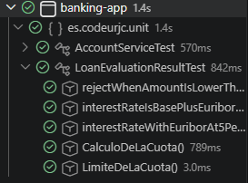


**Refactorización**

La refactorización que se hizo, fue para hacerse más general, en el sentido de que no se aplique únicamente al caso de que amount = 500, si no para todos los casos en los que amount<1000 (cantidad dada por el enunciado)

```java
public LoanEvaluationResult RechazoAprobadoAutomáticoBasico(LoanRequest request, double interestRate) {
    if (request.getAmount()< 1000) {
        return new LoanEvaluationResult(false,"Cantidad fuera de rango");
    }
    return new LoanEvaluationResult(true, "Aprobado", request.getAmount(), interestRate, 0);
}
```
**Captura de que TODOS los tests PASAN tras la refactorización**


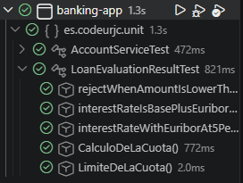

**CICLO 2: INPUT: 60000€, 24 meses con 5000€ de ingresos y OUTPUT: RECHAZADO**

**Código de test**
```java
@Test
public void rejectWhenAmountIsGreaterThen50000(){
    //Given
    LoanRequest request = new LoanRequest();
    request.setAmount(60000);
    request.setTermMonths(24);
    request.setCustomerBalance(5000);

    //When
    when(euriborService.getEuribor()).thenReturn(3.0);
    LoanEvaluationResult result = algorithm.evaluate(request);

    //Then 
    assertFalse(result.isApproved());
    assertEquals("Cantidad fuera de rango", result.getReason());
}
```

**Mensaje del test añadido que NO PASA**

```log
org.opentest4j.AssertionFailedError: expected: <false> but was: <true>
```

**Código mínimo para que el test pase**

Agregué una condición extra al if, que el amount sea igual a 60000 (cantidad del test)

```java
public LoanEvaluationResult RechazoAprobadoAutomáticoBasico(LoanRequest request, double interestRate) {
    if (request.getAmount() < 1000 || request.getAmount() == 60000) {
        return new LoanEvaluationResult(false,"Cantidad fuera de rango");
    }

    return new LoanEvaluationResult(true, "Aprobado", request.getAmount(), interestRate, 0);
}
```

**Captura de que TODOS los test PASAN**

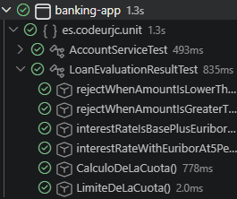

**Refactorización**

Consta de agregar una variable para agrupar las llamadas de request.getamount(), y modificar la condición para convertirla en un rango (amount <= 50000, dado por el enunciado)

```java
public LoanEvaluationResult RechazoAprobadoAutomáticoBasico(LoanRequest request, double interestRate) {
    double amount = request.getAmount();
    if (amount < 1000 || amount > 50000) {
        return new LoanEvaluationResult(false,"Cantidad fuera de rango");
    }

    return new LoanEvaluationResult(true, "Aprobado", amount, interestRate, 0);
}
```
**Captura de que TODOS los tests PASAN tras la refactorización**


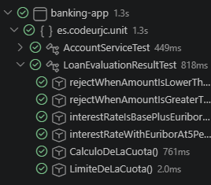


**CICLO 3: INPUT: 20000€, 4 meses con 5000€ de ingresos y OUTPUT: RECHAZADO**

**Código de test**
```java
@Test
public void rejectWhenTimeIsLowerThan6Months(){
    //Given
    LoanRequest request = new LoanRequest();
    request.setAmount(20000);
    request.setTermMonths(4);
    request.setCustomerBalance(5000);

    //When
    when(euriborService.getEuribor()).thenReturn(3.0);
    LoanEvaluationResult result = algorithm.evaluate(request);

    //Then 
    assertFalse(result.isApproved());
    assertEquals("Plazo no válido", result.getReason());
}
```

**Mensaje del test añadido que NO PASA**

```log
org.opentest4j.AssertionFailedError: expected: <false> but was: <true>
```

**Código mínimo para que el test pase**

Agregué un if con la condicion de que cumpla con la cantidad de meses del test.

```java
public LoanEvaluationResult RechazoAprobadoAutomáticoBasico(LoanRequest request, double interestRate) {
    double amount = request.getAmount();
    if (amount < 1000 || amount > 50000 ) {
        return new LoanEvaluationResult(false,"Cantidad fuera de rango");
    }
    if (request.getTermMonths()==4) {
        return new LoanEvaluationResult(false,"Plazo no válido");
    }

    return new LoanEvaluationResult(true, "Aprobado", amount, interestRate, 0);
}
```

**Captura de que TODOS los test PASAN**

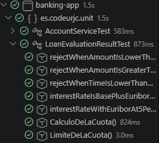


**Refactorización**

La refactorización consta de modificar la condición a que se cumpla para el rango de menor a 6 meses (dado por el enunciado)

```java
public LoanEvaluationResult RechazoAprobadoAutomáticoBasico(LoanRequest request, double interestRate) {
    double amount = request.getAmount();
    if (amount < 1000 || amount > 50000 ) {
        return new LoanEvaluationResult(false,"Cantidad fuera de rango");
    }
    if (request.getTermMonths()<6) {
        return new LoanEvaluationResult(false,"Plazo no válido");
    }

    return new LoanEvaluationResult(true, "Aprobado", amount, interestRate, 0);
}
```
**Captura de que TODOS los tests PASAN tras la refactorización**

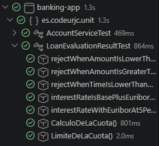

**CICLO 4: INPUT: 20000€, 130 meses con 5000€ de ingresos y OUTPUT: RECHAZADO**

**Código de test**
```java
@Test
public void rejectWhenTimeIsHigherThan120Months(){
    //Given
    LoanRequest request = new LoanRequest();
    request.setAmount(20000);
    request.setTermMonths(130);
    request.setCustomerBalance(5000);

    //When
    when(euriborService.getEuribor()).thenReturn(3.0);
    LoanEvaluationResult result = algorithm.evaluate(request);

    //Then 
    assertFalse(result.isApproved());
    assertEquals("Plazo no válido", result.getReason());
}
```

**Mensaje del test añadido que NO PASA**

```log
org.opentest4j.AssertionFailedError: expected: <false> but was: <true>
```

**Código mínimo para que el test pase**

Agregué un if con la condicion de que cumpla con la cantidad de meses del test.

```java
public LoanEvaluationResult RechazoAprobadoAutomáticoBasico(LoanRequest request, double interestRate) {
    double amount = request.getAmount();
    if (amount < 1000 || amount > 50000 ) {
        return new LoanEvaluationResult(false,"Cantidad fuera de rango");
    }
    if (request.getTermMonths()<6 ||request.getTermMonths() == 130 ) {
        return new LoanEvaluationResult(false,"Plazo no válido");
    }

    return new LoanEvaluationResult(true, "Aprobado", amount, interestRate, 0);
}
```

**Captura de que TODOS los test PASAN**

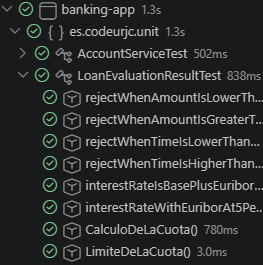


**Refactorización**

La refactorización consta de modificar la condición a que se cumpla para el rango de mayor a 120 meses (dado por el enunciado)

```java
public LoanEvaluationResult RechazoAprobadoAutomáticoBasico(LoanRequest request, double interestRate) {
    double amount = request.getAmount();
    if (amount < 1000 || amount > 50000 ) {
        return new LoanEvaluationResult(false,"Cantidad fuera de rango");
    }
    double time = request.getTermMonths
    if (time<6 ||time > 120 ) {
        return new LoanEvaluationResult(false,"Plazo no válido");
    }

    return new LoanEvaluationResult(true, "Aprobado", amount, interestRate, 0);
}
```
**Captura de que TODOS los tests PASAN tras la refactorización**

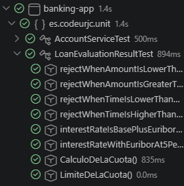


**CICLO 5: INPUT: 20000€, 24 meses con 500€ de ingresos y OUTPUT: RECHAZADO**

**Código de test**
```java
@Test
public void rejectWhenBalanceInsufficient(){
    //Given
    LoanRequest request = new LoanRequest();
    request.setAmount(20000);
    request.setTermMonths(24);
    request.setCustomerBalance(500);

    //When
    when(euriborService.getEuribor()).thenReturn(3.0);
    LoanEvaluationResult result = algorithm.evaluate(request);

    //Then 
    assertFalse(result.isApproved());
    assertEquals("Saldo insuficiente", result.getReason());
}
```

**Mensaje del test añadido que NO PASA**

```log
org.opentest4j.AssertionFailedError: expected: <false> but was: <true>
```

**Código mínimo para que el test pase**

Agregué un if con la condicion de que cumpla con el saldo que tiene el test.

```java
public LoanEvaluationResult RechazoAprobadoAutomáticoBasico(LoanRequest request, double interestRate) {
    double amount = request.getAmount();
    if (amount < 1000 || amount > 50000 ) {
        return new LoanEvaluationResult(false,"Cantidad fuera de rango");
    }

    double time = request.getTermMonths();
    if (time<6 ||time >120 ) {
        return new LoanEvaluationResult(false,"Plazo no válido");
    }

    if(request.getCustomerBalance() == 500){
        return new LoanEvaluationResult(false,"Saldo insuficiente");
    }

    return new LoanEvaluationResult(true, "Aprobado", amount, interestRate, 0);
}
```

**Captura de que TODOS los test PASAN**

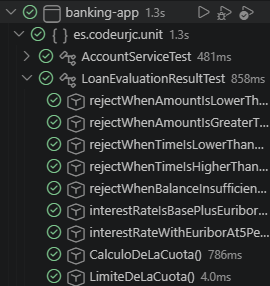


**Refactorización**

La refactorización consta de modificar la condición para que se cumpla cuando el 20% de la cantidad pedida sea mayor al balance.

```java
public LoanEvaluationResult RechazoAprobadoAutomáticoBasico(LoanRequest request, double interestRate) {
    double amount = request.getAmount();
    if (amount < 1000 || amount > 50000 ) {
        return new LoanEvaluationResult(false,"Cantidad fuera de rango");
    }
    double time = request.getTermMonths();
    if (time<6 ||time >120 ) {
        return new LoanEvaluationResult(false,"Plazo no válido");
    }

    if(amount * 0.2 > request.getCustomerBalance()){
        return new LoanEvaluationResult(false,"Saldo insuficiente");
    }

    return new LoanEvaluationResult(true, "Aprobado", amount, interestRate, 0);
}
```
**Captura de que TODOS los tests PASAN tras la refactorización**

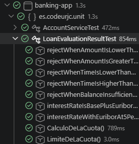

**CICLO 6: INPUT: 20000€, 24 meses con 5000€ de ingresos y OUTPUT: ACEPTADO**

Test demostrando que la función RechazoAprobadoAutomáticoBasico tiene un funcionamiento correcto.

**Código de test**
```java
@Test
public void approveLoan(){
    //Given
    LoanRequest request = new LoanRequest();
    request.setAmount(20000);
    request.setTermMonths(24);
    request.setCustomerBalance(5000);

    //When
    when(euriborService.getEuribor()).thenReturn(3.0);
    LoanEvaluationResult result = algorithm.evaluate(request);

    //Then 
    assertTrue(result.isApproved());
    assertEquals("Aprobado", result.getReason());
}
```

**Captura de que TODOS los test PASAN**

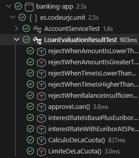

**CICLO 7: REFACTORIZACIÓN DE LOS TESTS**
Al finalizar los casos, se observó que se pueden refactorizar los tests, debido a que todos tenían la misma funcionalidad, por tanto se implementó un método que cree los casos y se pasen como parámetros al test resultante de agrupar todos los anteriores.

```java
private static Stream<Arguments> provideLoanRequestsForApprovalRejection() {
        return Stream.of(
                Arguments.of(new LoanRequest(500, 24, 5000, 5000), false, "Cantidad fuera de rango"),
                Arguments.of(new LoanRequest(60000, 24, 5000, 5000), false, "Cantidad fuera de rango"),
                Arguments.of(new LoanRequest(20000, 4, 5000, 5000), false, "Plazo no válido"),
                Arguments.of(new LoanRequest(20000, 240, 5000, 5000), false, "Plazo no válido"),
                Arguments.of(new LoanRequest(20000, 24, 5000, 500), false, "Saldo insuficiente"),
                Arguments.of(new LoanRequest(20000, 24, 5000, 5000), true, "Loan approved"));
}


@ParameterizedTest
    @MethodSource("provideLoanRequestsForApprovalRejection")
    public void loanApprovalRejectionTest(LoanRequest request, boolean expectedApproval, String expectedReason) {
        // Given
        when(euriborService.getEuribor()).thenReturn(3.0);

        // When
        LoanEvaluationResult result = algorithm.evaluate(request);

        // Then
        assertEquals(expectedApproval, result.isApproved());
        assertEquals(expectedReason, result.getReason());
    }
```

**Captura de que TODOS los test PASAN**  
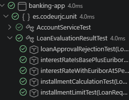


## 2. Cálculo del tipo de interés

**CICLO 1: INPUT: Euribor 3% y OUTPUT: interés total = 5%**

**Código de test**
```java
@Test
public void interestRateIsBasePlusEuriborTest(){
    // Given
    LoanRequest request = new LoanRequest();
    request.setAmount(20000);
    request.setTermMonths(24);
    request.setCustomerBalance(5000);
    request.setMonthlyIncome(5000);

    when(euriborService.getEuribor()).thenReturn(3.0);

    // When
    LoanEvaluationResult result = algorithm.evaluate(request);

    // Then
    assertEquals(5.0, result.getInterestRate());
}
```

**Mensaje del test añadido que NO PASA**

```
org.opentest4j.AssertionFailedError: expected: <5.0> but was: <0.0>
```

**Código mínimo para que el test pase**

Sumé el 2% de interes al euribor obtenido para que devuelva el interés esperado.

```java
public LoanEvaluationResult evaluate(LoanRequest request) {

    double interestRate = 2.0 + euriborService.getEuribor();

    return new LoanEvaluationResult(true, "Loan approved", request.getAmount(), interestRate, 0);
}

```

**Captura de que TODOS los test PASAN**

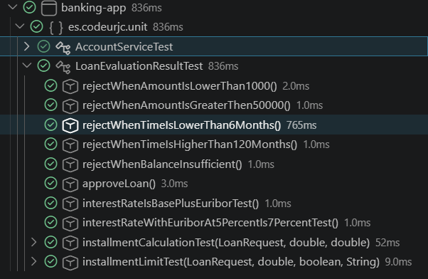

**Refactorización**

Extraje el cálculo del tipo de interés a una expresión más clara y utilicé la constante de interés base para mejorar la legibilidad.

```java
private static final double BASE_INTEREST_RATE = 2.0;

public LoanEvaluationResult evaluate(LoanRequest request) {

    double interestRate = BASE_INTEREST_RATE + euriborService.getEuribor();

    return new LoanEvaluationResult(true, "Loan approved", request.getAmount(), interestRate, 0);
}
```
**Captura de que TODOS los tests PASAN tras la refactorización**

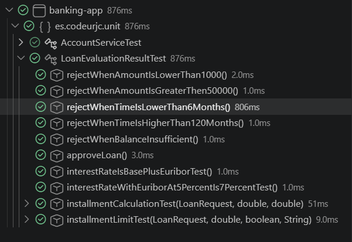


**CICLO 2: INPUT: Euribor 5% y OUTPUT: interés total = 7%**

**Código de test**
```java
@Test
public void interestRateWithEuriborAt5PercentIs7PercentTest(){
    // Given
    LoanRequest request = new LoanRequest();
    request.setAmount(20000);
    request.setTermMonths(24);
    request.setCustomerBalance(5000);
    request.setMonthlyIncome(5000);

    when(euriborService.getEuribor()).thenReturn(5.0);

    // When
    LoanEvaluationResult result = algorithm.evaluate(request);

    // Then
    assertEquals(7.0, result.getInterestRate());
}

```

**Mensaje del test añadido que NO PASA**

```
org.opentest4j.AssertionFailedError: expected: <7.0> but was: <0.0>
```

**Código mínimo para que el test pase**

Reutilicé el cálculo del ciclo anterior, sumando el 2% de interés base al Euribor para obtener el valor esperado.

```java
public LoanEvaluationResult evaluate(LoanRequest request) {

    double interestRate = 2.0 + euriborService.getEuribor();

    return new LoanEvaluationResult(true, "Loan approved", request.getAmount(), interestRate, 0);
}

```

**Captura de que TODOS los test PASAN**

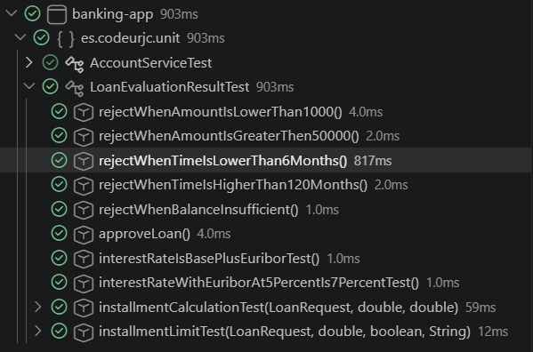

**Refactorización**

No fue necesaria refactorización en este ciclo, ya que el cálculo del interés quedó correctamente estructurado en el ciclo anterior y no hizo falta modificar ni mejorar el código para que este test pasara

**CICLO 3: REFACTORIZACIÓN DE LOS TESTS**

Al finalizar los casos, se observó que se pueden refactorizar los tests, debido a que todos tenían la misma funcionalidad, por tanto se implementó un método que cree los casos y se pasen como parámetros al test resultante de agrupar todos los anteriores.

```java 
@ParameterizedTest
@MethodSource("provideInterestRateCases")
public void interestRateCalculationTest(double euribor, double expectedInterestRate) {
    // Given
    LoanRequest request = new LoanRequest();
    request.setAmount(20000);
    request.setTermMonths(24);
    request.setCustomerBalance(5000);
    request.setMonthlyIncome(5000);

    when(euriborService.getEuribor()).thenReturn(euribor);

    // When
    LoanEvaluationResult result = algorithm.evaluate(request);

    // Then
    assertEquals(expectedInterestRate, result.getInterestRate());
}
```

**Captura de que TODOS los test PASAN**

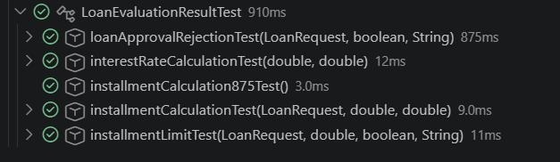

## 3. Cálculo de la cuota

**INPUT**: 20.000€, 24 meses con ingresos de 5000€ y con Euribor al 3%  
**OUTPUT**: 875

**3.1.1 Código de test**
```java
@Test
public void installmentCalculation875Test(){
    // Given
    LoanRequest request = new LoanRequest();
    request.setAmount(20000);
    request.setTermMonths(24);
    request.setCustomerBalance(5000);
    request.setMonthlyIncome(5000);

    when(euriborService.getEuribor()).thenReturn(3.0);

    // When
    LoanEvaluationResult result = algorithm.evaluate(request);

    // Then
    assertEquals(875, algorithm.installmentCalculation(request.getAmount(), request.getTermMonths() , result.getInterestRate()));
}
```

**3.1.2 Mensaje de test añadido que no pasa**
```log
java.lang.Error: Unresolved compilation problem: 
 The method installmentCalculation(double, int, double) is undefined for the type LoanApprovalAlgorithmthm
```

**3.1.3 Código mínimo para que pase el test**
```java
public double installmentCalculation(double amount, double termMonth, double interestType) {
    return 875;
}
```

**3.1.4 Captura de que TODOS los test PASAN**   
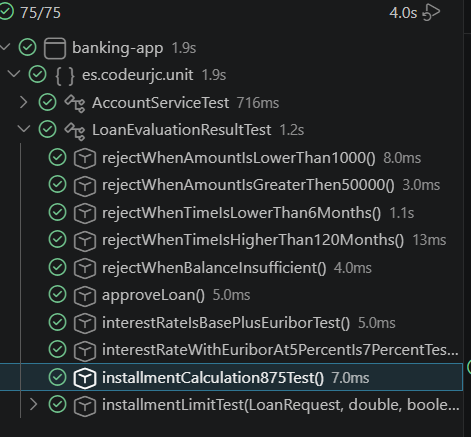


**INPUT**: 20.000€, 24 meses con ingresos de 5000€ y con Euribor al 3.5%  
**OUTPUT**: 879.17

**3.2.1 Código de test**
```java
@Test
public void installmentCalculation879_17Test(){
    // Given
    LoanRequest request = new LoanRequest();
    request.setAmount(20000);
    request.setTermMonths(24);
    request.setCustomerBalance(5000);
    request.setMonthlyIncome(5000);

    when(euriborService.getEuribor()).thenReturn(3.5);

    // When
    LoanEvaluationResult result = algorithm.evaluate(request);

    // Then
    assertEquals(879.17, algorithm.installmentCalculation(request.getAmount(), request.getTermMonths() , result.getInterestRate()));
}
```
**3.2.2 Mensaje de test añadido que no pasa**  
```log
org.opentest4j.AssertionFailedError: expected: [879.17] but was: [875.0]
```

**3.2.3 Código mínimo para que pase el test**
```java
public double installmentCalculation(double amount, double termMonth, double interestType) {
    double installment = amount * (1 + (interestType / 100)) / termMonth;
    BigDecimal resultRounded = new BigDecimal(installment).setScale(2, RoundingMode.HALF_UP);

    return resultRounded.doubleValue();
}
```

**3.2.4 Captura de que TODOS los test PASAN**  
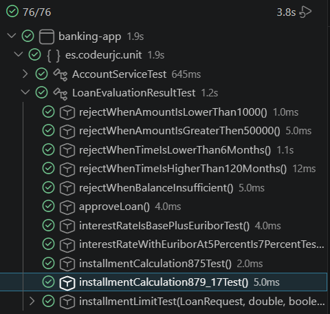

**INPUT**: 20.000€, 24 meses con ingresos de 5000€ y con Euribor al 5.0%
**OUTPUT**: 891.67

**3.3.1 Código de test**
```java
@Test
public void installmentCalculation891_67Test(){
    // Given
    LoanRequest request = new LoanRequest();
    request.setAmount(20000);
    request.setTermMonths(24);
    request.setCustomerBalance(5000);
    request.setMonthlyIncome(5000);

    when(euriborService.getEuribor()).thenReturn(5.0);

    // When
    LoanEvaluationResult result = algorithm.evaluate(request);

    // Then
    assertEquals(891.67, algorithm.installmentCalculation(request.getAmount(), request.getTermMonths() , result.getInterestRate()));
    }
```
**3.3.2 Mensaje de test añadido que no pasa**  
installmentCalculation891_67test() (Passed), in 2.0ms  
Este test pasa directamente sin tener que modificar código, ya que la fórmula implementada en el ciclo anterior en `installmentCalculation` ya cubre este caso.  

**3.3.3 Código mínimo para que pase el test**
```java
public double installmentCalculation(double amount, double termMonth, double interestType) {
    double installment = amount * (1 + (interestType / 100)) / termMonth;
    BigDecimal resultRounded = new BigDecimal(installment).setScale(2, RoundingMode.HALF_UP);

    return resultRounded.doubleValue();
}
```

**3.3.4 Captura de que TODOS los test PASAN**   
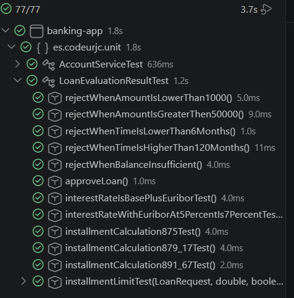

**3.3.5 Refactorizar**  
El `installmentCalculation875Test`, `installmentCalculation879_17Test` y `installmentCalculation891_67Test` hacen lo mismo pero con distintos datos de entrada. Esto genera código duplicado por lo que refactorizamos metiendo los datos en un `@MethodSource` y se los pasamos al nuevo test `installmentCalculationTest` como datos en `@ParameterizedTest`


```java
private static Stream<Arguments> provideLoanRequestsForInstallmentCalculation() {
    return Stream.of(
        Arguments.of(new LoanRequest(20000, 24, 5000, 5000), 3.0, 875),
        Arguments.of(new LoanRequest(20000, 24, 5000, 5000), 3.5, 879.17),
        Arguments.of(new LoanRequest(20000,24,5000,5000), 5.0 , 891.67 )
    );
}

@ParameterizedTest
@MethodSource("provideLoanRequestsForInstallmentCalculation")
public void installmentCalculationTest(LoanRequest loanRequest, double euribor, double expectedResult){
    // Given
    when(euriborService.getEuribor()).thenReturn(euribor);

    //When
    LoanEvaluationResult result = algorithm.evaluate(loanRequest);

    //Then
    assertEquals(expectedResult, algorithm.installmentCalculation(loanRequest.getAmount(), loanRequest.getTermMonths() , result.getInterestRate() ));
    }
```

**Captura de que los test pasan tran la refactorización**  
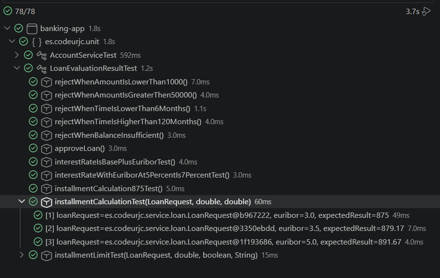


## 4. Límites de la cuota
**INPUT**: 20.000€, 24 meses con Euribor al 3% con ingresos de 2.000€  
**OUTPUT**: RECHAZADO  

**4.1.1 Código de test**
```java
@Test
public void installmentLimitDeclineTest(){
    //Given
    LoanApprovalAlgorithm loanApprovalAlgorithm = new LoanApprovalAlgorithm(3.0);
    LoanRequest loanRequest = new LoanRequest(20000, 24, 2000);
    
    //When
    LoanEvaluationResult loanEvalutaionResult = loanApprovalAlgorithm.evaluate(loanRequest);
    
    //Then
    assertFalse(loanEvalutaionResult.isApproved());
    assertEquals("Monthly installment exceeds 40% of income", loanEvalutaionResult.getReason());
}
```

**4.1.2 Mensaje del test añadido que NO PASA**
```log
java.lang.Error: Unresolved compilation problems: The constructor LoanApprovalAlgorithm(double) is undefined The constructor LoanRequest(int, int, int) is undefined
```

**4.1.3 Código mínimo para que el test pase**
```java
public LoanApprovalAlgorithm(double euribor) {}
```

```java
public LoanRequest(double amount, int termMonths, double montlyIncome){}
```

**4.1.4 Captura de que TODOS los test PASAN**  
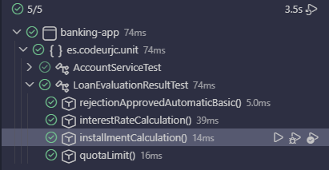


**INPUT**: 20.000€, 24 meses con Euribor al 3% con ingresos de 3.000€  
**OUTPUT**: APROBADO

**4.2.1 Código de test**
```java
@Test
public void installmentLimitApproveTest(){
    //Given
    LoanApprovalAlgorithm loanApprovalAlgorithm = new LoanApprovalAlgorithm(3.0);
    LoanRequest loanRequest = new LoanRequest(20000, 24, 3000);

    //When
    LoanEvaluationResult loanEvaluationResult = loanApprovalAlgorithm.evaluate(loanRequest);

    //Then
    assertTrue(loanEvaluationResult.isApproved());
    assertEquals("Loan approved", loanEvaluationResult.getReason());
}
```

**4.2.2 Mensaje del test añadido que NO PASA**
```log
Expected [true] but was [false]
```

**4.2.3 Código mínimo para que el test pase**  
- LoanApprovalAlgorithm:  
    - Añadir el parámetro `euribor` a la clase y rellenar el constructor de la clase.  
    - Escribir la condición para que sea true o false.  
- LoanRequest: Rellenar el constructor.  

```java
private double euribor;
    
public LoanApprovalAlgorithm(double euribor) {
    this.euribor = euribor;
}

public LoanEvaluationResult evaluate(LoanRequest request) {
    if (request.getMonthlyIncome() >= 3000) {
        return new LoanEvaluationResult(true, "Loan approved");
    }
    return new LoanEvaluationResult(false, "Monthly installment exceeds 40% of income");
}
```

```java
public LoanRequest(double amount, int termMonths, double montlyIncome){
    this.amount = amount;
    this.termMonths = termMonths;
    this.monthlyIncome = montlyIncome;
}
```

**4.2.4 Captura de que TODOS los test PASAN**  
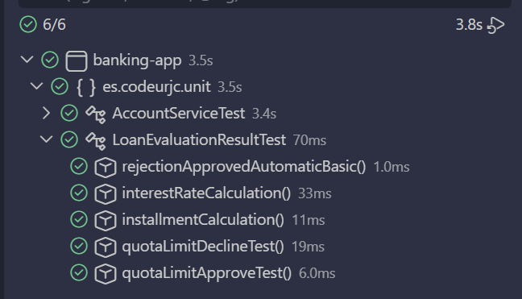


**INPUT**: 20.000€, 7 meses con Euribor al 5% con ingresos de 3.000€  
**OUTPUT**: RECHAZADO

**4.3.1 Código de test**
```java
@Test
public void installmentLimitDeclineShortTermTest(){
    //Given
    LoanApprovalAlgorithm loanApprovalAlgorithm = new LoanApprovalAlgorithm(5.0);
    LoanRequest loanRequest = new LoanRequest(20000, 7, 3000);

    //When
    LoanEvaluationResult loanEvaluationResult = loanApprovalAlgorithm.evaluate(loanRequest);

    //Then
    assertFalse(loanEvaluationResult.isApproved());
    assertEquals("Monthly installment exceeds 40% of income", loanEvaluationResult.getReason());
}
```

**4.3.2 Mensaje del test añadido que NO PASA**
```log
Expected [false] but was [true]
```

**4.3.3 Código mínimo para que el test pase**  
- LoanApprovalAlgorithm: Añadir otra condición al if.  

```java
public LoanEvaluationResult evaluate(LoanRequest request) {
    if ((request.getMonthlyIncome()) >= 3000 && (euribor == 3.0)) {
        return new LoanEvaluationResult(true, "Loan approved");
    }
    return new LoanEvaluationResult(false, "Monthly installment exceeds 40% of income");
}
```

**4.3.4 Captura de que TODOS los test PASAN**  
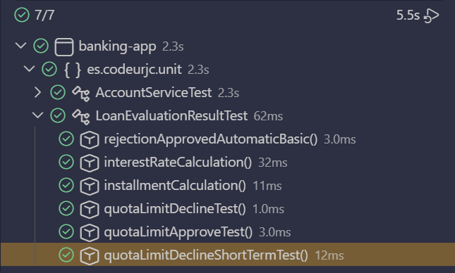  


**Refactorización 1**  
- LoanApprovalAlgorithm:  
    - Añadir funcionalidad a installmentLimit().  
    - Añadir constructor vacío para solucionar un error de java.  
    - Cambiar los ifs en evaluate().  
- LoanEvaluationResultTest: Unificar y parametrizar los tests.  

```java
public LoanApprovalAlgorithm() {}

public LoanEvaluationResult evaluate(LoanRequest request) {
    if (installmentLimit(request)) {
        return new LoanEvaluationResult(true, "Loan approved");
    }
    return new LoanEvaluationResult(false, "Monthly installment exceeds 40% of income");
}

public boolean installmentLimit(LoanRequest request) {
    double interestRate = 2.0 + euribor;
    double installment = (request.getAmount() * (1 + interestRate / 100)) / request.getTermMonths();
    double limit = 0.4 * request.getMonthlyIncome();
    return installment <= limit;
}
```

```java
private static Stream<Arguments> provideLoanRequestsForInstallmentLimit() {
    return Stream.of(
        Arguments.of(new LoanRequest(20000, 24, 2000), 3.0, false, "Monthly installment exceeds 40% of income"),
        Arguments.of(new LoanRequest(20000, 24, 3000), 3.0, true, "Loan approved"),
        Arguments.of(new LoanRequest(20000, 7, 3000), 5.0, false, "Monthly installment exceeds 40% of income")
    );
}

@ParameterizedTest
@MethodSource("provideLoanRequestsForInstallmentLimit")
public void installmentLimitTest(LoanRequest loanRequest, double euribor, boolean expectedApproval,  String expectedReason){		
    //Given
    LoanApprovalAlgorithm loanApprovalAlgorithm = new LoanApprovalAlgorithm(euribor);
    
    //When
    LoanEvaluationResult loanEvaluationResult = loanApprovalAlgorithm.evaluate(loanRequest);
    
    //Then
    assertEquals(expectedApproval, loanEvaluationResult.isApproved());
    assertEquals(expectedReason, loanEvaluationResult.getReason());
}
```

**Captura de que TODOS los tests PASAN tras la refactorización**  
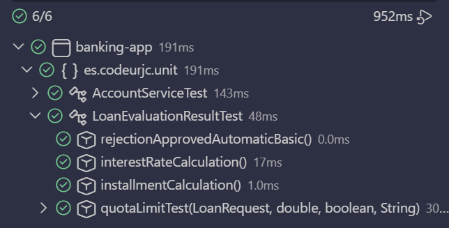  

**Refactorización 2**  
- LoanApprovalAlgorithm:  
    - Combinar mi trabajo con el de mis compañeros.  
    - Añadir interestRate como parámetro para reutilizar código.  
    - Eliminar `euribor` y cambiarlo por `euriborService`.  
    - Añadir e inicializar los constructores (el de sin parámetros es para solucionar un warning de java).  
- LoanEvaluationResultTest:  
    - Adaptar al cambio de euribor por euriborService.  
    - Añadir customerBalance a `provideLoanRequestsForInstallmentLimit` para que el test pase con las modificaciones de mis compañeros.  
    - Quitar `loanApprovalAlgorithm` de `installmentLimitTest` para adaptarse al @BeforeEach realizado por mis compañeros.  
    - Añadir monthlyIncome a los test de Raul para que funcionen.  
- LoanRequest: Modificar el constructor para añadir `customerBalance` y así solventar el error en installmentLimitTest() producido por la unión del merge entre todos.  

```java
private static final double BASE_INTEREST_RATE = 2.0;
private final EuriborService euriborService;

public LoanApprovalAlgorithm() {
    this.euriborService = new EuriborService();
}

public LoanApprovalAlgorithm(EuriborService euriborService){
    this.euriborService = euriborService;
}

public LoanEvaluationResult evaluate(LoanRequest request) {
    double interestRate = BASE_INTEREST_RATE + euriborService.getEuribor();

    //1. Basic automatic Reject/Approve - Matias
    double amount = request.getAmount();
    if (amount < 1000 || amount > 50000 ) {
        return new LoanEvaluationResult(false,"Cantidad fuera de rango");
    }

    double time = request.getTermMonths();
    if (time<6 ||time >120 ) {
        return new LoanEvaluationResult(false,"Plazo no válido");
    }

    if(amount * 0.2 > request.getCustomerBalance()){
        return new LoanEvaluationResult(false,"Saldo insuficiente");
    }


    //4. installment limit - Carla
    if (!installmentLimit(request, interestRate)) {
        return new LoanEvaluationResult(false, "Monthly installment exceeds 40% of income");
    }
    return new LoanEvaluationResult(true, "Loan approved", amount, interestRate, 0);
    
}
```

```java
private static Stream<Arguments> provideLoanRequestsForInstallmentLimit() {
    return Stream.of(
        Arguments.of(new LoanRequest(20000, 24, 2000, 5000), 3.0, false, "Monthly installment exceeds 40% of income"),
        Arguments.of(new LoanRequest(20000, 24, 3000, 5000), 3.0, true, "Loan approved"),
        Arguments.of(new LoanRequest(20000, 7, 3000, 5000), 5.0, false, "Monthly installment exceeds 40% of income")
    );
}

@ParameterizedTest
@MethodSource("provideLoanRequestsForInstallmentLimit")
public void installmentLimitTest(LoanRequest loanRequest, double euribor, boolean expectedApproval, String expectedReason){		
    //Given
    when(euriborService.getEuribor()).thenReturn(euribor);
    
    //When
    LoanEvaluationResult loanEvaluationResult = algorithm.evaluate(loanRequest);
    
    //Then
    assertEquals(expectedApproval, loanEvaluationResult.isApproved());
    assertEquals(expectedReason, loanEvaluationResult.getReason());
}

@Test
public void approveLoan(){
    //Given
    LoanRequest request = new LoanRequest();
    request.setAmount(20000);
    request.setTermMonths(24);
    request.setCustomerBalance(5000);
    request.setMonthlyIncome(5000);

    //When
    when(euriborService.getEuribor()).thenReturn(3.0);
    LoanEvaluationResult result = algorithm.evaluate(request);

    //Then 
    assertTrue(result.isApproved());
    assertEquals("Loan approved", result.getReason());
}

@Test
public void interestRateIsBasePlusEuriborTest(){
    // Given
    LoanRequest request = new LoanRequest();
    request.setAmount(20000);
    request.setTermMonths(24);
    request.setCustomerBalance(5000);
    request.setMonthlyIncome(5000);

    when(euriborService.getEuribor()).thenReturn(3.0);

    // When
    LoanEvaluationResult result = algorithm.evaluate(request);

    // Then
    assertEquals(5.0, result.getInterestRate());
}

@Test
public void interestRateWithEuriborAt5PercentIs7PercentTest(){
    // Given
    LoanRequest request = new LoanRequest();
    request.setAmount(20000);
    request.setTermMonths(24);
    request.setCustomerBalance(5000);
    request.setMonthlyIncome(5000);

    when(euriborService.getEuribor()).thenReturn(5.0);

    // When
    LoanEvaluationResult result = algorithm.evaluate(request);

    // Then
    assertEquals(7.0, result.getInterestRate());
}
```

```java
public LoanRequest(double amount, int termMonths, double montlyIncome, double customerBalance){
    this.amount = amount;
    this.termMonths = termMonths;
    this.monthlyIncome = montlyIncome;
    this.customerBalance = customerBalance;
}
```

**Captura de que TODOS los tests PASAN tras la refactorización**  
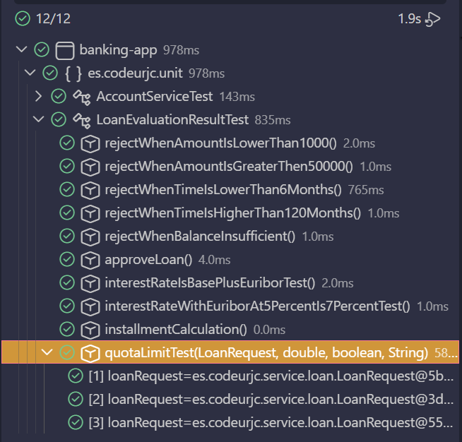  

**Refactorización 3**  
- Cambiar todo en lo que ponga `quota` por `installment` para no llamar a lo mismo de manera distinta.  
- LoanApprovalAlgorithm:  
    - Añadir `MAX_LIMIT` como variable global.  
    - Añadir cálculo de la cuota a la función `evaluate()` para evitar calcularlo dos veces.  
    - Añadir parámetro `installment` a `installmentLimit()`.  

```java
private static final double MAX_LIMIT = 0.4; // 40% of monthly income

public LoanEvaluationResult evaluate(LoanRequest request) {
    //2. Interest rate calculation - Raul
    double interestRate = BASE_INTEREST_RATE + euriborService.getEuribor();

    //3. Installment calculation - Alejandro
    double installment = installmentCalculation(request.getAmount(), request.getTermMonths(), interestRate);

    //1. Basic automatic Reject/Approve - Matias
    double amount = request.getAmount();
    if (amount < 1000 || amount > 50000 ) {
        return new LoanEvaluationResult(false,"Cantidad fuera de rango");
    }

    double time = request.getTermMonths();
    if (time<6 ||time >120 ) {
        return new LoanEvaluationResult(false,"Plazo no válido");
    }

    if(amount * 0.2 > request.getCustomerBalance()){
        return new LoanEvaluationResult(false,"Saldo insuficiente");
    }


    //4. Installment limit - Carla
    if (!installmentLimit(request, interestRate, installment)) {
        return new LoanEvaluationResult(false, "Monthly installment exceeds 40% of income");
    }

    return new LoanEvaluationResult(true, "Loan approved", request.getAmount(), interestRate, 0);
    
}

public boolean installmentLimit(LoanRequest request, double interestRate, double installment) {
    double limit = MAX_LIMIT * request.getMonthlyIncome();
    return installment <= limit;
}
```

**Captura de que TODOS los tests PASAN tras la refactorización**  
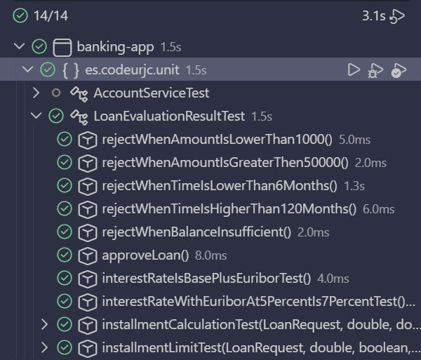  
